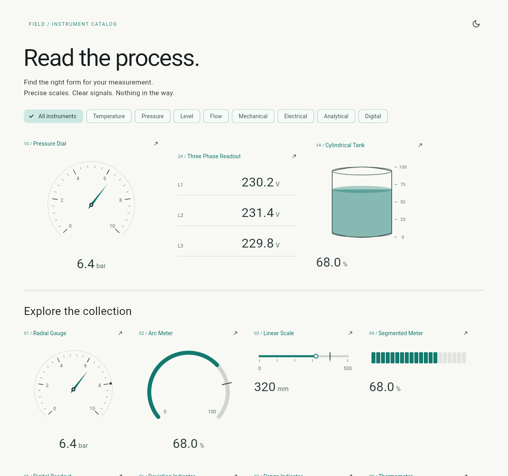
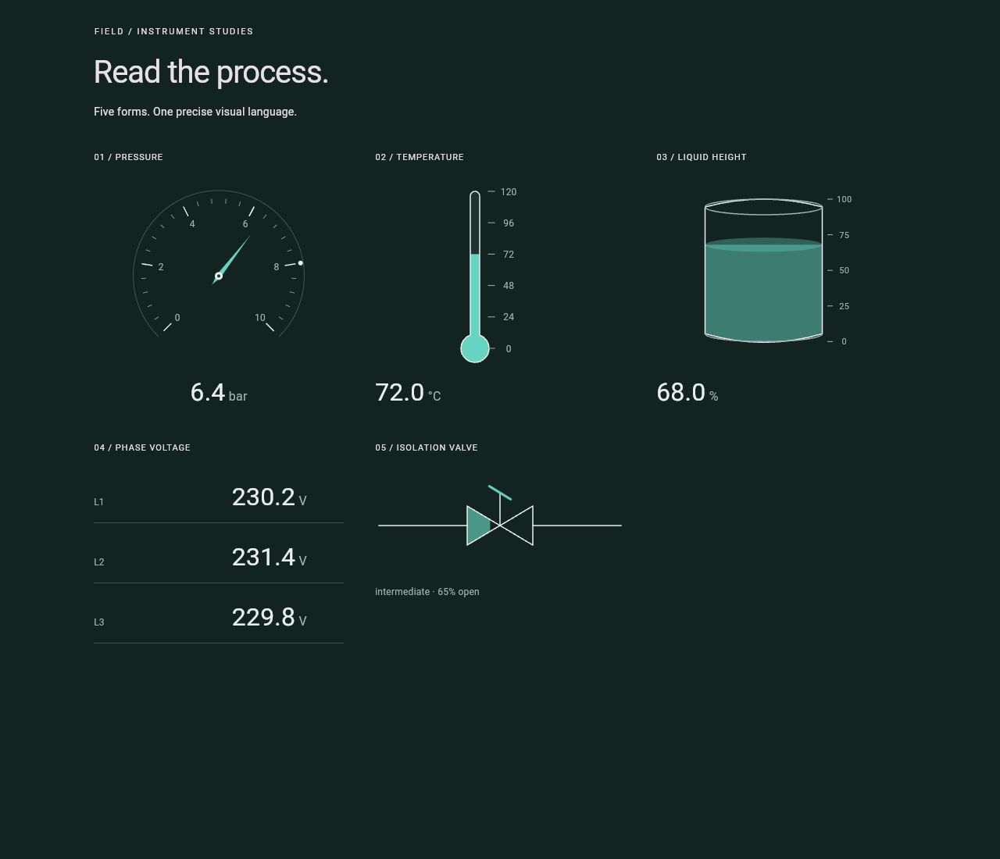

# Industrial Instruments

**33 measurement and equipment widgets for Flutter.** Precise scales, readable engineering values, and reusable geometry that sits naturally on a plain background.



**Version 0.2.1** removes charts and introduces explicit parameter presets and a measurement-focused catalog. This is a breaking update from 0.1.0. See the [migration guide](doc/MIGRATION.md).

## Start with an instrument

```dart
import 'package:industrial_instruments/industrial_instruments.dart';

RadialGauge(value: 6.4, min: 0, max: 10, unit: 'bar')
Thermometer(value: 72, min: 0, max: 120, unit: '°C')
LiquidTank(value: 65, min: 0, max: 100, unit: '%')
ThreePhaseReadout(values: [230.2, 231.4, 229.8], unit: 'V')
```

Add the package to your application:

```yaml
dependencies:
  industrial_instruments: ^0.2.1
```

Flutter is the only runtime dependency. Requires Dart 3.9+ and Flutter 3.35+. MIT licensed. No forced cards, font, scaffold, theme extension, controller, networking, or state-management package.

## Choose the right form

| Family | Instruments |
|---|---|
| General | RadialGauge, ArcMeter, LinearScale, SegmentedMeter, DigitalReadout, DeviationIndicator, RangeIndicator |
| Temperature | Thermometer, TemperatureProbe |
| Pressure | PressureDial, DifferentialPressureIndicator, VacuumGauge |
| Level & storage | LiquidTank, CylindricalTank, HorizontalTank, SiloIndicator, LevelTube |
| Flow & movement | FlowIndicator, PipeFlow, RotationIndicator, PositionIndicator, AngleIndicator |
| Electrical | BatteryIndicator, ThreePhaseReadout, CenterZeroMeter, FrequencyMeter |
| Equipment & signals | PumpIndicator, MotorIndicator, ValveIndicator, FanIndicator, ConveyorIndicator, StateLight, ContactIndicator |

[Examples for all 33](doc/EXAMPLES.md) · [Minimum sizes and behavior](doc/BEHAVIOR.md) · [Customization](doc/CUSTOMIZATION.md)

## Or begin with a parameter

Presets configure labels, units and formatting. They never choose safe operating ranges, infer equipment state, or convert your values.

```dart
final bearing = ParameterPresets.temperatureC.copyWith(
  label: 'Bearing temperature',
  precision: 2,
);

bearing.radialGauge(value: 72.4, min: 0, max: 120)
ParameterPresets.conductivityMicro.readout(value: 840)
ParameterPresets.powerFactor(
  convention: 'Positive = import; lagging',
).readout(value: 0.94)
```

[Parameter and unit coverage](doc/PARAMETERS.md) includes thermal, pressure, mechanical, electrical, analytical and digital measurements.

## Clear data meaning

* Null, NaN and infinity remain missing readings. Visual positions clamp without replacing the actual number.
* Equipment state and animation are separate. All equipment is presentational; nothing issues machine commands.
* VacuumGauge requires gauge-relative or absolute pressure explicitly.
* Vessel fills represent **height**. HorizontalTank volume mode requires an application-supplied `heightFraction`; no volume formula is silently assumed.
* Three-phase readings stay separate. No averages, conversions, power, energy, or phase calculations are inferred.
* Animation is opt-in, respects reduced motion, and continues from its current visual position during rapid updates.



## Explore and validate

```sh
cd example
flutter pub get
flutter run -d chrome
```

The gallery groups instruments by temperature, pressure, level, flow, mechanical, electrical, analytical and digital measurements. Detail views include range/unit inputs, value controls, color choices, light/dark switching, animation and copyable integration code.

[Recording instructions](doc/RECORDING.md) · [Validation and limitations](doc/VALIDATION.md) · [Completion checklist](doc/COMPLETION-0.2.0.md)

```sh
dart format --output=none --set-exit-if-changed lib test example/lib
flutter analyze
flutter test
flutter pub publish --dry-run
```

See [CONTRIBUTING.md](CONTRIBUTING.md) for development guidance.
