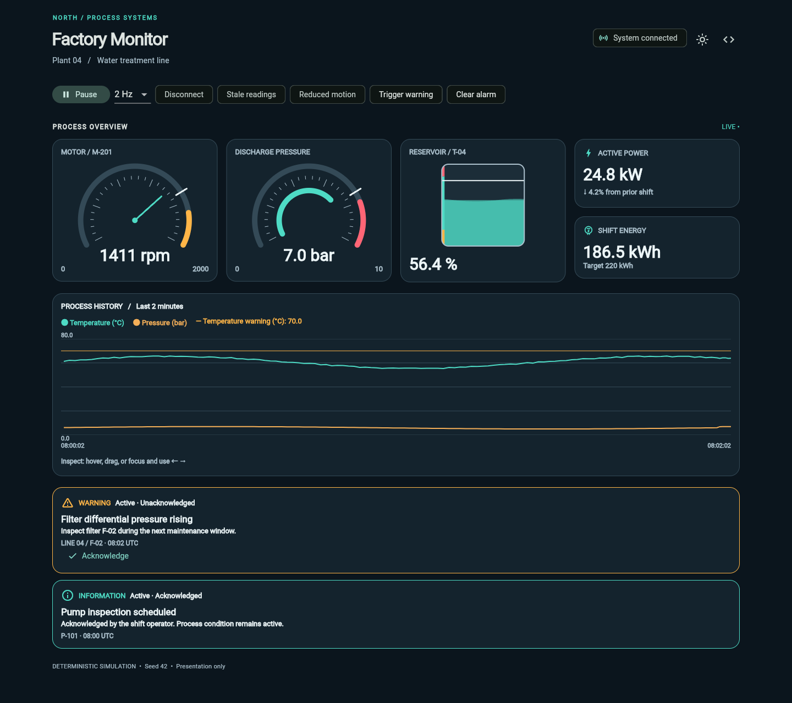

# industrial_widgets

Readable, customizable Flutter instruments for industrial telemetry dashboards—with honest missing-data states and bounded live trends.



**0.1.0 · MIT · Flutter only at runtime**

Build IoT, energy, water-treatment and manufacturing views without coupling your UI to MQTT, HTTP, persistence or process logic. This package is presentation software, is not safety-certified, and must not be the sole interface for safety-critical machine control.

## Install

Requires Flutter **3.35+** and Dart **3.9+**. Tested here with Flutter 3.35.6 / Dart 3.9.2.

This source is not yet published. Until publication, use a local path:

```yaml
dependencies:
  industrial_widgets:
    path: ../industrial_widgets
```

After the first pub.dev release:

```sh
flutter pub add industrial_widgets
```

`industrial_widgets` returned HTTP 404 from the pub.dev package API when checked on 2026-10-27. That does not reserve the name; recheck before publishing.

## A working instrument

```dart
import 'package:flutter/material.dart';
import 'package:industrial_widgets/industrial_widgets.dart';

void main() => runApp(MaterialApp(
  theme: ThemeData(
    brightness: Brightness.dark,
    extensions: const [IndustrialTheme.dark],
  ),
  home: Scaffold(
    body: Center(
      child: SizedBox(
        width: 300,
        child: IndustrialGauge(
          label: 'Motor speed',
          reading: const IndustrialReading(1480),
          range: IndustrialRange(0, 2000),
          unit: 'rpm',
          target: 1500,
          formatter: (value) => value.toStringAsFixed(0),
        ),
      ),
    ),
  ),
));
```

## Instruments

| Widget | What it does | Ownership |
| --- | --- | --- |
| `IndustrialGauge` | Needle or arc, negative ranges, operating bands, major/minor ticks, target | Controlled reading |
| `IndustrialTank` | Vertical/horizontal vessel, percent or engineering values, bands, target, optional ripple | Controlled reading; internal animation only |
| `IndustrialValueCard` | Value, unit, icon, target/range and application-supplied context | Controlled reading |
| `IndustrialAlarmBanner` | Severity, source, time, acknowledgement and optional dismissal | Controlled immutable alarm |
| `IndustrialTrendChart` | Multiple series, real time positions, operating overlays, pointer/touch/keyboard inspection | Listens to caller-owned controller |

Supply bounded **width**, allow natural height, and put dashboards in a scrollable. Gauge and tank labels grow with text scale. `GaugeStyle`, `TankStyle` and `TrendChartStyle` group related settings. All supported symbols are exported from `package:industrial_widgets/industrial_widgets.dart`; `src/` is internal.

## Theme

```dart
final industrial = IndustrialTheme.dark.copyWith(
  accent: const Color(0xFF64D8FF),
  radius: 12,
  spacing: 20,
  valueStyle: const TextStyle(fontSize: 32, fontWeight: FontWeight.w600),
);
final theme = ThemeData(
  brightness: Brightness.dark,
  extensions: [industrial],
);
```

`IndustrialTheme.light` is a complete light palette. Without an extension, widgets select a palette from Material brightness. Every widget also accepts `theme:` for a local override. Tokens cover colors, typography, spacing, border color and corner radius. Bands and series have explicit colors. Use `TrendChartStyle(seriesColors: {'temperature': Colors.teal.shade800})` to change series colors when switching theme without replacing history.

## Live data without a networking dependency

The application owns acquisition and lifecycle. `bind` accepts any `Stream<TrendUpdate>` and cancels its subscription when the controller is disposed. A complete mountable example is in [stream_example.dart](example/lib/stream_example.dart).

```dart
late final IndustrialTrendController trends;

@override
void initState() {
  super.initState();
  trends = IndustrialTrendController(
    series: const [
      TrendSeries(id: 'temperature', name: 'Temperature',
        unit: '°C', color: Colors.teal),
    ],
    maxPointsPerSeries: 2000,
    retention: const Duration(minutes: 10),
  );
  final start = DateTime.now().toUtc();
  trends.bind(Stream<TrendUpdate>.periodic(
    const Duration(milliseconds: 500),
    (i) => TrendUpdate('temperature', TrendPoint(
      start.add(Duration(milliseconds: 500 * i)), 60 + (i % 10) / 10,
    )),
    onError: (error, stack) { /* report transport errors in application state */ },
  );
}

@override
void dispose() {
  trends.dispose(); // Cancels bindings; chart itself never disposes this controller.
  super.dispose();
}

// In build:
// IndustrialTrendChart(controller: trends)
```

For value widgets, pass new `IndustrialReading` values through a `ValueListenableBuilder` or `StreamBuilder` around the affected instrument. Batch related chart points with `addAll` for a single notification. Do not rebuild an entire large dashboard for every packet. Factory Monitor deliberately uses a small single-state example to keep its simulation readable.

## Missing data, stale data and connections

```dart
const reading = IndustrialReading(
  6.4,
  quality: MeasurementQuality.uncertain,
  freshness: ReadingFreshness.stale,
  connection: ConnectionStatus.disconnected,
);
```

These are independent classifications. A disconnected device may still have a finite last-known reading; it remains visible with a disconnected label. Bad quality is explicitly labeled, not silently normalized to a valid measurement.

- `null`, NaN and infinities display **—**. Zero is a real measurement.
- Gauge/tank geometry clamps to range; the displayed actual value stays unchanged. A tank in percentage mode can display **120%** with an out-of-range label and a full vessel.
- Targets clamp visually as well. Bands are clipped to the configured range; later overlapping bands paint above earlier ones.
- Widgets never infer freshness or start per-reading timers. Compute age in one application-owned shared clock and pass `freshness`. The optional timestamp is metadata, not a freshness policy.
- DateTime instants are sorted irrespective of timezone. No implicit conversion occurs. Chart defaults show HH:mm:ss in the supplied zone; alarm defaults use ISO-8601. Provide `timestampFormatter` and explicitly call `toLocal()` or `toUtc()` for your UI policy.
- Repeated updates retarget gauge/tank transitions from their current visual position. Numeric text changes immediately. Missing readings remove the indicator immediately. Reduced motion bypasses transitions.
- Tank ripples are opt-in, and stop for missing, bad, stale or disconnected readings, when disabled, or when `MediaQuery.disableAnimations` is true.

## Alarm lifecycle

`active → acknowledged` records operator awareness; **acknowledged remains active**. Only your process logic changes state to `cleared`. `onAcknowledge` is an action request, not an automatic mutation. Rebuild the banner with your new `IndustrialAlarm` state. No timer or widget automatically clears an alarm.

Dismissal is hidden unless both `allowDismiss: true` and `onDismiss` are supplied. Dismissal only requests removal of the presentation; it does not clear a process alarm. Severity and lifecycle appear as text as well as color and icon.

## Chart behavior and practical limits

- The controller stores sorted immutable snapshots; last arrival wins at duplicate instants, including replacement with a gap. Unknown series IDs throw before a batch changes history.
- Retention is relative to the **global newest event timestamp**, inclusive at the cutoff. A hard default cap of 2,000 samples **per series** also applies. Late events outside retention are discarded. A future-dated event can evict old history: validate device clocks before ingestion.
- There is no wall-clock expiration timer. The view follows the newest event by default. Pass `endTime` from an application-owned clock to make a window advance during disconnection; old samples then leave the view even without ingestion.
- Missing and non-finite samples break lines. Long time intervals are not automatically gaps: insert an explicit null event when acquisition stops. Single samples render as dots.
- All series share one numeric Y axis; units are labeled but **not converted**. Normalize heterogeneous quantities yourself or use separate charts if their scales obscure each other.
- Automatic bounds use visible finite values, thresholds and bands, with padding. Empty data uses a 0–1 baseline with padding. Fixed bounds clip plotted values; inspection retains actual values. For extreme double spans that cannot be represented, automatic bounds fall back to ±`double.maxFinite / 2` and clip geometry.
- First/min/max/last pixel-bucket sampling preserves spikes and endpoints within each contiguous run. Gaps are never bridged. Alternating valid/gap data cannot be compressed much, so the history cap remains the hard bound. Inspection uses original samples, not reduced ones.
- Hover, tap or drag to inspect the nearest retained sample of each series. Inspection shows each sample's own time. Tab to the plot and use arrow keys; Escape exits inspection.

Start with the default cap and a handful of series. This is a focused dashboard chart, not a replacement for a scientific plotter: no zoom/pan engine, multiple Y axes, timezone database, export engine or aggregation service. Sampling is outside paint; instruments use repaint boundaries. Profile your actual device, widget count and update rate before increasing limits. See [measured profile results](doc/PERFORMANCE.md).

The renderer is custom because this release needs a small, gap-aware time plot with explicit retention semantics. A general chart dependency would add a larger API and rendering layer without replacing the telemetry model. The only runtime dependency is the Flutter SDK; `flutter_test` and `flutter_lints` are development-only. Third-party types do not enter the public API.

## Factory Monitor and demo

```sh
cd example
flutter run -d chrome
# Automatic 17-second showcase: warning, acknowledge, then theme switch.
flutter run -d chrome --dart-define=DEMO=true
```

Seed 42 populates the dashboard before the first update. Controls cover pause, 1/2/10 Hz, theme, alarm trigger/clear/acknowledge, disconnection, stale readings and reduced motion. The code icon opens copyable examples. See [recording instructions and assets](doc/DEMO.md).

## Accessibility

Readings have semantic descriptions, units and explicit quality text; high-frequency updates are **not** live regions. Alarms include severity names and icons. Chart inspection and alarm actions support keyboard input. Charts expose names, units and inspected values; they are not a full screen-reader data table. Provide a table/export in the host application when required. Themes support text scaling and reduced motion; custom colors remain the integrator's responsibility. Physical screen-reader testing is still required before deployment.

## Platforms and verification

The package uses Flutter widgets and painters with no platform plugins, and is intended for Android, iOS, web, macOS, Windows and Linux. **Runtime verification in this delivery is Chrome web only**; other platforms are not claimed as tested. Formatting, analysis, Chrome tests, web builds and publishing dry-run results are recorded in [VALIDATION.md](doc/VALIDATION.md). The installed SDK lacked native test and Flutter analysis-server artifacts; the working Dart analyzer and Chrome test runner were used instead.

## License and contributing

MIT, chosen by the owner; see [LICENSE](LICENSE). [Source and issues](https://github.com/Appu-Devloper/industrial_widgets). Contributions should include a reproducer, focused behavior tests and documentation for public changes. Follow [CONTRIBUTING.md](CONTRIBUTING.md). This source has not been published; a package-name recheck and release review remain necessary. Publishing requires a separate explicit instruction.
